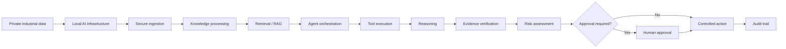

# Sovereign Industrial AI Workbench

### SIH26117

**Documentation Set — Master Index**

| Field | Value |
|---|---|
| Problem statement | SIH26117 — Sovereign On-Premise Agentic AI Workbench for Confidential Industrial Work |
| Working product name | Sovereign Industrial AI Workbench (**SIAW**) — brand name not finalised |
| Document version | 1.0 |
| Document date | 2026-08-22 |
| Document status | Design and specification baseline. **No component of this system is implemented as of this document date.** |
| Intended audience | SIH evaluators, engineering team, security reviewers, prospective enterprise buyers, prospective investors |

---

## How to read this document set

This is a **specification and architecture baseline**, not a report on a running system. Every capability described here is labelled with an explicit maturity marker. Readers evaluating claims should treat the marker as authoritative and ignore any prose that reads more confidently than the marker allows.

### Status taxonomy

| Marker | Meaning |
|---|---|
| `[MVP-P0]` | Committed scope for the SIH prototype. Must exist and must demonstrate end-to-end. |
| `[DIFF-P1]` | Differentiating capability. Targeted within the SIH window only if P0 is complete and stable. |
| `[PROPOSED]` | Architected and specified in this document set, but not scheduled for the prototype. Design is intended to be buildable without rework. |
| `[FUTURE]` | Post-SIH commercial roadmap. Named so the architecture does not foreclose it; no design detail is guaranteed. |
| `[OPTIONAL]` | Deployment-dependent. Present or absent according to customer environment, not according to product version. |

### Evidence conventions

- External market, regulatory and competitor statements are cited inline to the source that was actually read. Where a figure could not be verified from a primary or reputable secondary source, the document says so rather than substituting an estimate.
- All costs, prices, valuations and performance figures are **illustrative targets or planning estimates**, explicitly labelled. None are quotes, benchmarks or achieved results.
- Security sections describe controls and residual risk. They do not assert that the system is secure, that it has no vulnerabilities, or that it guarantees compliance with any named regulation.

---

## Section map

### Part A — Problem and product

| # | Document | Contents |
|---|---|---|
| 01 | [Executive Summary](01-executive-summary.md) | Problem, solution, users, value proposition, why now, differentiators, impact |
| 02 | [Problem Statement Analysis](02-problem-analysis.md) | Confidentiality, sovereignty, agentic, integration and governance problems; root causes |
| 03 | [Product Vision](03-product-vision.md) | Vision, mission, long-term objective, target market, positioning |
| 04 | [User Personas](04-user-personas.md) | Nine personas with goals, problems, permissions and interactions |

### Part B — Requirements

| # | Document | Contents |
|---|---|---|
| 05 | [Functional Requirements](05-functional-requirements.md) | FR-001 … FR-118 with priority, actor, dependencies, acceptance criteria |
| 06 | [Non-Functional Requirements](06-non-functional-requirements.md) | NFR-001 … NFR-046 across eleven quality attributes |

### Part C — Architecture

| # | Document | Contents |
|---|---|---|
| 07 | [System Architecture](07-system-architecture.md) | Layered architecture, service topology, data architecture, trust zones |
| 08 | [Component Architecture](08-component-architecture.md) | Every runtime component, its contract, its state and its failure mode |
| 09 | [Data Flow](09-data-flow.md) | Ingestion, query, agent and action flows as sequence diagrams |
| 10 | [RAG Architecture](10-rag-architecture.md) | Parsing, chunking, hybrid retrieval, reranking, permission filtering, Evidence Graph |
| 11 | [Agent Architecture](11-agent-architecture.md) | Agent lifecycle, state machine, nine agent specifications, delegation, recovery |
| 12 | [Multimodal Architecture](12-multimodal-architecture.md) | Text, image, table, OCR, audio, video, sensor series, cross-modal reasoning |
| 13 | [Security Architecture](13-security-architecture.md) | Threat model, trust boundaries, AI-specific attack surfaces, controls, residual risk |
| 14 | [Governance Architecture](14-governance-architecture.md) | Policy Engine, Risk Engine, Approval Engine, HITL/HOTL, explainability |
| 15 | [Audit Architecture](15-audit-architecture.md) | Event taxonomy, execution trace model, tamper-evident hash chain |
| 16 | [Industrial Integration](16-industrial-integration.md) | ERP, MES, SCADA, CMMS, SQL, MQTT, OPC UA integration patterns |
| 17 | [Deployment Architecture](17-deployment-architecture.md) | Development, enterprise, air-gapped topologies; offline update path |
| 18 | [Technology Stack](18-technology-stack.md) | Layer-by-layer selection with rationale and MVP/future split |

### Part D — Interfaces and implementation contracts

| # | Document | Contents |
|---|---|---|
| 19 | [API Architecture](19-api-architecture.md) | 14 REST resource groups, endpoint contracts, error model |
| 20 | [Database Design](20-database-design.md) | 26 proposed tables, ER diagram, indexing and retention strategy |
| 21 | [UI/UX Architecture](21-ui-ux-architecture.md) | Nine workspaces, information architecture, user journeys |

### Part E — Quality, scope and operations

| # | Document | Contents |
|---|---|---|
| 22 | [Failure Handling](22-failure-handling.md) | Ten failure classes, detection, degradation policy, user-visible behaviour |
| 23 | [AI Evaluation](23-ai-evaluation.md) | Retrieval, faithfulness, agent and tool metrics; golden datasets; regression gates |
| 24 | [Performance Requirements](24-performance-requirements.md) | Proposed latency and throughput targets with hardware assumptions |
| 25 | [MVP Scope](25-mvp-scope.md) | P0 / P1 / P2 split, explicit non-goals, demonstration script |

### Part F — Business

| # | Document | Contents |
|---|---|---|
| 26 | [Business Model](26-business-model.md) | Customers, buyer personas, packaging, illustrative pricing, revenue mix |
| 27 | [Competitive Analysis](27-competitive-analysis.md) | Seven named competitors in four categories, sourced feature matrix |
| 28 | [Differentiation](28-differentiation.md) | Six defensible differentiators and the honest limits of each |
| 29 | [Business Economics](29-business-economics.md) | Prototype, MVP, enterprise and infrastructure cost models |
| 30 | [Market Opportunity](30-market-opportunity.md) | TAM/SAM/SOM derived bottom-up with stated assumptions |
| 31 | [Product Roadmap](31-product-roadmap.md) | Phase 0 through Phase 4 with exit criteria |
| 32 | [Risk Analysis](32-risk-analysis.md) | 28 risks with probability, impact and mitigation |
| 33 | [Competitive Moat](33-competitive-moat.md) | What compounds, what does not, and switching-cost mechanics |
| 34 | [Future Vision](34-future-vision.md) | Evolution toward an industrial AI operating layer |
| 35 | [Final Product Definition](35-final-product-definition.md) | Canonical one-line, one-paragraph and architectural definitions |

---

## The system in one line

> A sovereign, on-premise agentic AI workbench that turns confidential industrial data into evidence-backed decisions and governed actions without that data leaving the organisation's network perimeter.

## The system in one flow

## Reading paths

| If you are a… | Read, in order |
|---|---|
| SIH evaluator (30 minutes) | 01, 02, 25, 07, 11, 14, 28 |
| Security reviewer | 13, 15, 14, 17, 09, 22 |
| Engineer joining the build | 25, 07, 08, 19, 20, 10, 11 |
| Business / investor reviewer | 01, 26, 27, 29, 30, 31, 32, 33 |
| Prospective industrial buyer | 01, 04, 16, 17, 13, 14, 15, 24 |

---

## Terminology

Terms are defined at first substantive use and used consistently thereafter. The most load-bearing ones:

| Term | Definition |
|---|---|
| **Sovereign deployment** | All model inference, retrieval, storage and orchestration occur on infrastructure the customer owns or controls, with no outbound dependency on a third-party AI service at request time. |
| **Air-gapped operation** | Deployment on a network with no route to the public internet, where the platform functions with zero outbound network calls including telemetry, licence checks and model-registry lookups. |
| **Agentic AI** | An AI system that plans multi-step work, selects and invokes tools, observes results, and revises its plan — as distinct from single-turn text generation. |
| **Agentic RAG** | Retrieval that is iterative and self-assessing: the system evaluates the sufficiency of retrieved context and issues further, differently-formulated queries when confidence is low. |
| **Evidence Graph** | A directed graph linking each asserted conclusion to the specific document spans, data rows, image regions and tool outputs that support it. |
| **Risk tier** | A classification (LOW / MEDIUM / HIGH / CRITICAL) assigned to a proposed agent action, determining the approval and logging path it must follow. |
| **Sovereignty Score** | A measured, continuously computed indicator of how much of the deployment's data locality, network egress, model locality, audit coverage and approval coverage is actually satisfied. |
| **HITL / HOTL** | Human-in-the-loop: a human must approve before the action executes. Human-on-the-loop: the action executes and a human supervises and can reverse it. |
