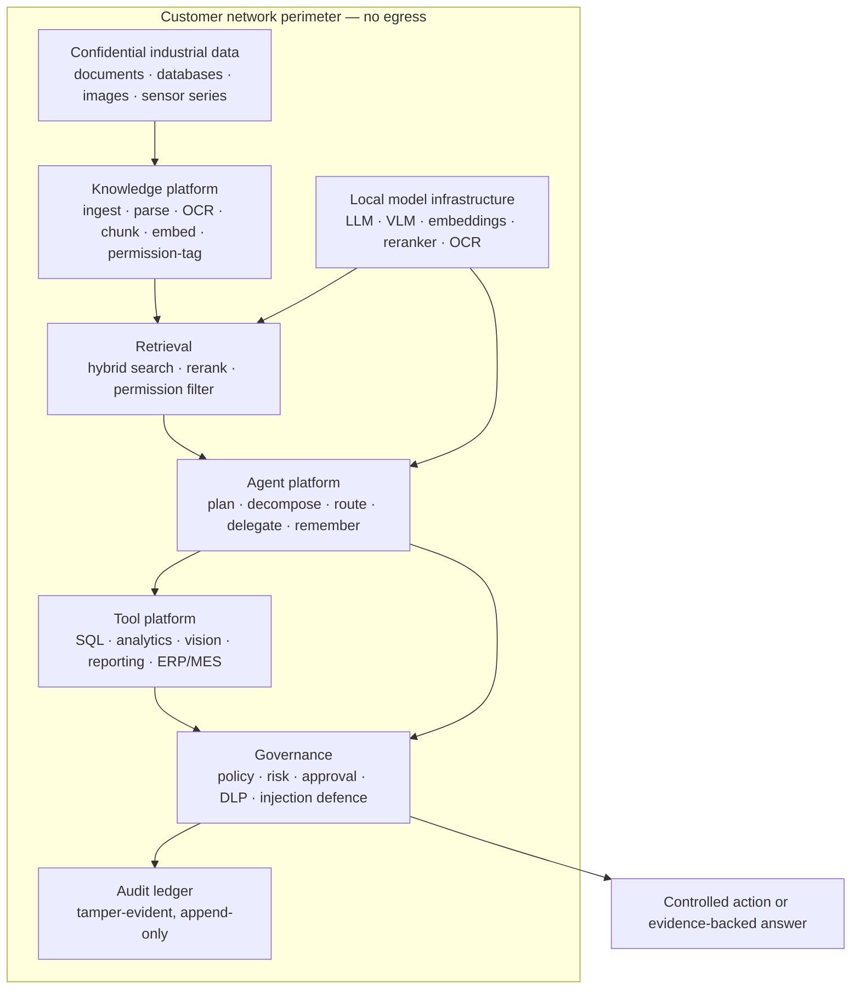
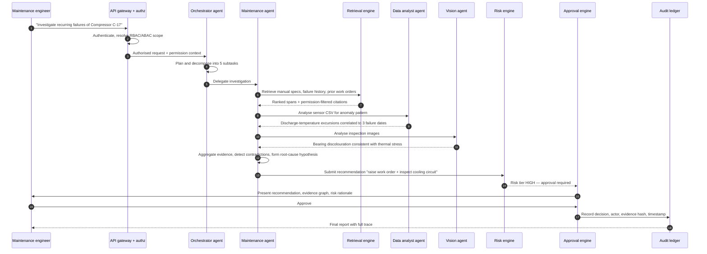
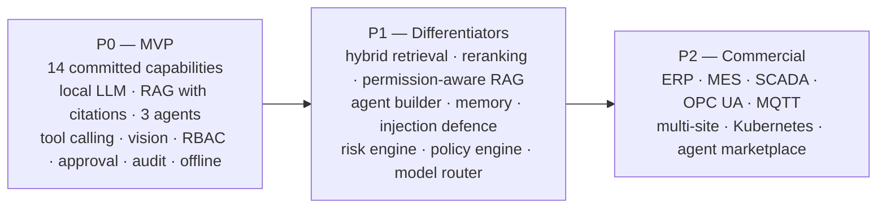

# 01 — Executive Summary

**Document:** 01 of 35 · **Status:** Design baseline · **See also:** [Index](00-index.md)

---

## 1.1 The problem in one paragraph

Industrial organisations hold the data that would make AI most valuable to them — equipment manuals, failure histories, maintenance logs, inspection photographs, process deviations, sensor archives, ERP and MES records — and it is precisely this data they cannot send to an external AI provider. The barrier is not reluctance about AI. It is a combination of intellectual-property exposure, contractual confidentiality with customers, sector regulation, defence and export-control constraints, and the plain physical fact that many plants and secure facilities have no usable route to the public internet. The result is a structural gap: the organisations with the highest-value proprietary knowledge are the ones least able to apply modern AI to it.

## 1.2 The solution

A **Sovereign Industrial AI Workbench** — a platform installed inside the organisation's own network that runs open-weight language, vision and embedding models on local GPUs, indexes the organisation's confidential documents and data, and exposes that capability through governed AI agents that can plan work, query internal systems, analyse data and images, and propose or execute operational actions.

The governing principle:

> **Bring AI to the organisation's data — not the organisation's data to external AI.**

The platform is deliberately **not** positioned as a chatbot. It is a workbench for building, deploying, operating, governing and auditing industrial AI agents. The chat surface is one of nine workspaces; the others manage knowledge, agents, models, tools, policies, approvals, audit and system health.

### Canonical flow

## 1.3 Target users

The platform serves four distinct user classes, which is why it is a workbench rather than an assistant.

| Class | Representative roles | Primary need |
|---|---|---|
| **Practitioners** | Maintenance engineer, quality engineer, design engineer, control-room operator | Answer an operational question, in minutes, with evidence they can defend to a supervisor |
| **Builders** | AI administrator, automation engineer, plant digitalisation lead | Configure agents, knowledge bases, tools and policies without writing platform code |
| **Approvers** | Plant manager, shift supervisor, maintenance planner | See a proposed action with its supporting evidence and risk tier, then approve, modify, reject or escalate |
| **Assurance** | IT administrator, security officer, compliance officer, internal and external auditor | Prove what the system did, on what basis, under whose authority, and that no data left the perimeter |

Detailed personas: [04 — User Personas](04-user-personas.md).

## 1.4 Core value proposition

The commercial argument is not that the AI is capable. It is that a class of work which is currently slow, expensive and dependent on scarce senior people becomes fast, repeatable and auditable — without creating a new data-exposure liability.

| Value | Mechanism | Where specified |
|---|---|---|
| Investigation time collapses | One agent run replaces a manual sequence of document search, database queries, image review and report drafting | [11](11-agent-architecture.md) |
| Answers are defensible | Every conclusion carries an Evidence Graph traceable to document spans, data rows and image regions | [10](10-rag-architecture.md) |
| Automation is bounded | Every proposed action is risk-tiered and gated by policy before it can touch a production system | [14](14-governance-architecture.md) |
| Retiring expertise is retained | Historical reports, shift logs and failure records become queryable operational knowledge rather than dormant files | [10](10-rag-architecture.md) |
| Exposure risk does not increase | Data, embeddings, prompts, model weights and logs all remain inside the perimeter | [13](13-security-architecture.md), [17](17-deployment-architecture.md) |
| Audit burden falls | Every retrieval, tool call, decision and approval is recorded in a tamper-evident ledger | [15](15-audit-architecture.md) |

## 1.5 Why now

Three conditions became simultaneously true, and none of them was true three years ago.

**1. Open-weight models became good enough to be useful on a single industrial-grade server.** Quantised open-weight models in the 7B–70B range, served by mature local runtimes, now handle instruction-following, tool-calling and document reasoning at a quality that is adequate for bounded industrial tasks. Sovereign deployment stopped requiring a research lab's compute budget.

**2. Enterprise AI shifted from generation to action.** The major platforms have all moved toward agents that call tools and touch systems of record rather than merely producing text — Microsoft Foundry ships an agent service, tool connectors and an agent control plane ([microsoft.com](https://azure.microsoft.com/en-us/products/ai-foundry/)); NVIDIA ships NeMo agent tooling and reference agent blueprints ([nvidia.com](https://www.nvidia.com/en-in/data-center/products/ai-enterprise/)); Palantir exposes chatbots and logic bound to an Ontology with least-privilege model access ([palantir.com](https://www.palantir.com/docs/foundry/agent-studio/overview)). The category the platform targets is now a recognised category, which removes the burden of educating the market.

**3. Governance expectations arrived before the technology settled.** The NIST AI Risk Management Framework organises AI risk work around four functions — Govern, Map, Measure, Manage — and has published a dedicated Generative AI Profile (NIST-AI-600-1, July 2024) ([nist.gov](https://www.nist.gov/itl/ai-risk-management-framework)). The EU AI Act's substantive obligations phase in with most of the Act applying from 2 August 2026 and Article 6(1) high-risk classification from 2 August 2027 ([artificialintelligenceact.eu](https://artificialintelligenceact.eu/implementation-timeline/)). India's Digital Personal Data Protection Act, 2023 has commenced in stages, with Data Protection Board provisions from 13 November 2025 and remaining provisions scheduled through 13 May 2027 ([summary source](https://en.wikipedia.org/wiki/Digital_Personal_Data_Protection_Act,_2023)). Buyers are being asked to evidence AI governance at the same moment they are being asked to adopt AI. A platform that produces that evidence as a by-product of operating is timed correctly.

> **Note on the third point.** Regulatory dates and obligations are cited as market context only. Nothing in this document set constitutes legal advice, and no claim is made that deploying this platform makes an organisation compliant with any named instrument.

## 1.6 Major differentiators

The honest starting position is that sovereign RAG, local models, agent orchestration, human approval and audit logging **already exist in shipping products**. Tosh.AI markets on-premise and air-gapped editions with sovereign RAG, an allow-listed tool router, human approval gates and attributable logging ([tosh.ai](https://www.tosh.ai/)). Claiming these as differentiators would be false. The defensible differentiation is narrower and more specific:

| # | Differentiator | Why it is defensible |
|---|---|---|
| 1 | **Industrial-first agent library** | Prebuilt Maintenance, Quality, Compliance and Vision agents with industrial task decompositions, not a generic agent builder that a customer must fill in |
| 2 | **Evidence Graph, not citation lists** | Conclusions decompose into a traversable graph of supporting spans, rows and image regions, with contradiction detection between sources |
| 3 | **Risk Engine as a first-class object** | Actions carry a computed risk tier that drives approval topology — including multi-party approval for CRITICAL actions — rather than a binary "needs approval" flag |
| 4 | **Measured Sovereignty Score** | Egress, model locality, audit coverage and approval coverage are continuously measured and displayed, converting a marketing claim into an auditable metric |
| 5 | **Vendor-neutral industrial integration** | Designed for mixed estates (Siemens plus Rockwell plus ABB plus legacy PLCs) rather than a single automation vendor's ecosystem |
| 6 | **Deployment-in-a-box** | Offline installer with pre-staged model artefacts, targeting days-to-first-value in an air-gapped environment rather than a multi-month integration programme |

Full treatment, including where each differentiator is weak: [28 — Differentiation](28-differentiation.md).

## 1.7 Flagship demonstration

A single workflow demonstrates every architectural layer at once: **industrial failure investigation.**

Inputs: a compressor equipment manual (PDF), twelve months of maintenance reports (PDF/DOCX), a sensor export (CSV), a historical failure register (XLSX), and a set of inspection photographs.

Query: *"Investigate the recurring failures of Compressor C-17."*

This one run exercises local inference, hybrid retrieval, permission-aware filtering, multi-agent delegation, tabular analysis, vision analysis, cross-modal evidence aggregation, risk classification, human approval, controlled action and audit. It is therefore both the MVP acceptance test and the demonstration script. See [25 — MVP Scope](25-mvp-scope.md).

## 1.8 Expected impact

Impact is stated as a **mechanism plus a measurement method**, not as a headline number. The platform ships the instrumentation needed to measure its own effect, because unverifiable ROI claims are the fastest way to lose an industrial buyer.

| Impact | Mechanism | How it is measured |
|---|---|---|
| Reduced investigation time | Parallel retrieval, analysis and vision replace serial manual work | Baseline vs. platform time-to-first-defensible-hypothesis, per investigation class |
| Reduced knowledge search time | Hybrid permission-aware retrieval over the full document estate | Time-to-answer on a fixed question set, before and after |
| Fewer repeat failures | Failure-history correlation surfaces recurrence that per-incident review misses | Repeat-failure rate per asset class over rolling windows |
| Faster, evidenced compliance response | SOP-versus-practice comparison with cited deviations | Time to assemble an audit evidence pack |
| Knowledge retention | Historical reports become queryable rather than archival | Share of answered queries whose evidence predates the current workforce |
| Lower data-exposure risk | Zero request-time third-party dependency | Sovereignty Score: measured egress attempts, model locality, audit coverage |
| Bounded automation risk | Risk tiering plus policy-gated approval | Share of executed actions with a recorded approval and complete trace |

### What the platform explicitly does not claim

- It does not claim to predict equipment failure. It correlates recorded evidence and cites it. Predictive maintenance modelling is `[FUTURE]`.
- It does not claim to replace engineering judgement. Every consequential action routes to a human.
- It does not claim to eliminate hallucination. It constrains, detects and surfaces it — see [23 — AI Evaluation](23-ai-evaluation.md).
- It does not claim regulatory compliance. It produces the evidence an organisation needs in order to argue its own compliance case.

## 1.9 Scope discipline

The single largest execution risk for a platform of this breadth is attempting all of it. The scope split is therefore explicit and enforced:

Nine agents are specified in [11 — Agent Architecture](11-agent-architecture.md). **Three** are in P0. The remaining six are specified so that the orchestrator, registry and tool contracts do not need rework when they are added — which is the actual engineering purpose of specifying them early.

---

**Next:** [02 — Problem Statement Analysis](02-problem-analysis.md)
