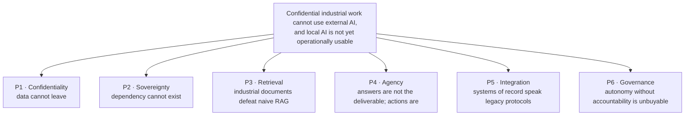
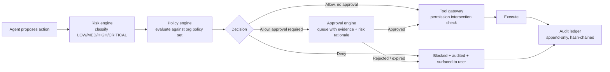

# 02 — Problem Statement Analysis

**Document:** 02 of 35 · **Status:** Analysis · **See also:** [Index](00-index.md)

---

## 2.1 Why this analysis exists

The problem statement can be restated as "industrial firms want private AI." That framing is true and useless — it produces a product that is a local chatbot. This section decomposes the problem into six independent failure modes, identifies the **root cause** of each, and states which architectural decision addresses it. A capability in this platform that does not trace back to one of these six problems is scope creep and should be cut.

---

## 2.2 P1 — The confidentiality problem

### What breaks

An engineer with a failing compressor has, in principle, everything needed to diagnose it: a 400-page OEM manual, three years of shift logs, a sensor archive, and photographs from the last teardown. In practice the engineer reads perhaps two of these, because reading all of them costs more time than the failure costs. The obvious remedy — paste the manual and the logs into a capable external model — is unavailable, and not for one reason but for five overlapping ones:

| Constraint | Concrete form in industry |
|---|---|
| Third-party IP obligation | OEM manuals and drawings are licensed, not owned. Uploading them can breach the supply agreement. |
| Customer confidentiality | A tier-1 automotive supplier's process data describes its customer's product. Disclosure obligations flow through the contract chain. |
| Own trade secret | Process parameters, tooling geometry, formulation and yield data are the firm's competitive position. |
| Sector regulation and export control | Defence, aerospace and nuclear supply chains carry classification and export-control constraints where the transfer itself is the violation. |
| Personal data | Shift logs, operator names, incident reports and CCTV frames carry personal data whose processing is regulated — India's DPDP Act obliges data fiduciaries across collection, storage and any other processing operation ([summary source](https://en.wikipedia.org/wiki/Digital_Personal_Data_Protection_Act,_2023)). |

### Root cause

**The value of industrial data is inseparable from its sensitivity.** The documents that most improve an answer are exactly the ones under the strongest disclosure constraints. Redaction does not resolve this: a manual with part numbers removed cannot answer a question about a part.

### Consequence in practice

Firms do not stop wanting AI; they route around the control. Engineers use personal accounts on personal devices with retyped or screenshotted content. The organisation now has the exposure **and** none of the audit trail. Shadow AI is the observed failure mode, and it is worse than either abstention or sanctioned adoption.

### Architectural response

Processing, embedding, indexing, inference, logging and storage all occur inside the perimeter. No request-time third-party dependency exists in any path — including the paths that are easy to forget: OCR services, embedding APIs, reranker APIs, telemetry, error reporting, licence validation and model-registry lookups. See [13](13-security-architecture.md) and [17](17-deployment-architecture.md).

---

## 2.3 P2 — The sovereignty problem

### What breaks

"On-premise" is routinely claimed and rarely true in the strict sense. A deployment can be entirely on customer hardware and still fail a sovereignty audit because:

- the orchestration framework resolves packages from a public registry at build or run time;
- the model runtime checks a hosted registry for weights or manifests;
- observability ships traces to a vendor endpoint;
- licence enforcement phones home;
- a "local" embedding step silently falls back to a hosted API when the local model is unavailable;
- a document parser fetches remote fonts, schemas or OCR language packs.

Each is individually defensible. Collectively they mean the deployment cannot pass an air-gap test, and an air-gap test is a binary gate for the defence, nuclear and classified-facility buyers who need this product most.

### Root cause

**The auxiliary ecosystem around open-weight models was built on cloud assumptions.** Model weights are openly available; the surrounding supply chain — registries, package indexes, telemetry, evaluation services, vector-database cloud control planes — assumes connectivity. Sovereignty fails at the seams, not at the model.

### Consequence in practice

Procurement discovers the gap during security review, months into a sales cycle. The vendor cannot remediate quickly because the dependency is architectural. The deal converts to a pilot that never leaves the DMZ.

### Architectural response

Three structural commitments, each testable:

1. **Egress-deny by default.** The platform is designed to run with an egress-deny network policy. Any component that requires egress is either removed or marked `[OPTIONAL]` and disabled in the sovereign profile.
2. **Offline artefact bundle.** Container images, model weights, tokenisers, OCR language data, Python and Node dependency sets are pre-staged into a signed offline bundle. See [17.6](17-deployment-architecture.md).
3. **Sovereignty Score as a measured control.** Egress attempts, external model calls, audit coverage and approval coverage are counted continuously and displayed. A blocked egress attempt is an auditable security event, not a silent retry. See [14.7](14-governance-architecture.md).

> This is a design commitment, not a proof. Verifying it requires an independent network-level test in the target environment, which is listed as a P1 verification task in [23](23-ai-evaluation.md).

---

## 2.4 P3 — The retrieval problem: why naive RAG fails on industrial documents

### What breaks

Standard RAG — embed chunks, retrieve top-k by cosine similarity, generate — degrades sharply on industrial corpora. Four specific failure modes:

**Failure 1 — Structure loss.** A maintenance manual's meaning lives in its structure: a torque value belongs to a specific bolt in a specific procedure step under a specific machine variant. Flatten it into 512-token chunks and the value survives while its scope does not. The model then confidently applies a Variant B torque to a Variant A machine. This class of error is worse than no answer, because it is actionable and wrong.

**Failure 2 — Non-prose content.** Industrial documents are substantially tables, P&ID and schematic diagrams, dimensioned drawings, revision blocks, and scanned annotations. Text-only extraction either drops these or emits token soup. A P&ID's information content is topological — what connects to what — and a text extractor preserves none of it.

**Failure 3 — Vocabulary mismatch.** The engineer types "C-17 keeps tripping." The manual says "high discharge temperature shutdown, ref. 4.7.2." Dense embeddings sometimes bridge this and sometimes do not; exact identifiers such as `C-17`, `P/N 4021-B`, `ISO 8573-1:2010` are precisely where dense retrieval is weakest and lexical search is strongest.

**Failure 4 — Single-pass finality.** Naive RAG retrieves once. If the first retrieval is poor, generation proceeds anyway on inadequate context. The system has no mechanism to notice its own insufficiency and no mechanism to try a different formulation.

### Root cause

Two causes compound. First, **foundation models are text-centric by training**, so spatial and topological engineering reasoning is a weak point rather than a strength. Second, **retrieval was designed as a stateless lookup**, whereas industrial diagnosis is inherently multi-hop: identify the variant, then find the procedure for that variant, then find the tolerance in the procedure, then check the deviation history against that tolerance.

### Architectural response

| Failure | Response | Status |
|---|---|---|
| Structure loss | Structure-aware chunking that preserves document hierarchy, and propagates section, revision and equipment-variant metadata onto every chunk | `[MVP-P0]` |
| Non-prose content | Vision-language parsing for diagram and scanned pages; table extraction to a structured representation queried as data rather than prose | `[MVP-P0]` for tables and scans, `[DIFF-P1]` for diagram topology |
| Vocabulary mismatch | Hybrid retrieval: dense vectors plus lexical BM25, fused and then reranked by a cross-encoder | `[DIFF-P1]` |
| Single-pass finality | Agentic retrieval loop: sufficiency assessment, query reformulation, bounded re-retrieval | `[DIFF-P1]` |

Detail in [10 — RAG Architecture](10-rag-architecture.md).

---

## 2.5 P4 — The agency problem

### What breaks

The engineer's actual job is not "obtain an answer." It is: determine why the asset failed, decide what to do, get that decision approved, and cause the work to happen. A system that returns a well-cited paragraph has completed perhaps 30% of the task. The remainder — cross-checking the sensor archive, comparing against prior incidents, drafting the work order, routing it for approval — remains manual.

Moving from answering to acting introduces problems that do not exist in a chat system:

- **Planning under uncertainty.** The correct decomposition of "investigate recurring failures" depends on what the first retrieval finds. A statically scripted pipeline cannot adapt; a fully autonomous planner is unpredictable in ways industrial buyers will not accept.
- **Tool selection with consequences.** A read-only SQL query and a work-order creation are both "tool calls," but they carry incomparable risk. A flat tool interface is a governance defect.
- **Multi-agent trust.** Once agents call agents, one agent's output becomes another's input. Retrieved document text is untrusted input; if it reaches a planner unmarked, a malicious or merely misleading document can steer tool selection. This is the inter-agent poisoning problem, and it is the direct analogue of OWASP's LLM01 Prompt Injection and LLM08 Excessive Agency ([owasp.org](https://owasp.org/www-project-top-10-for-large-language-model-applications/)).
- **Failure semantics.** A chat system that fails produces a bad paragraph. An agentic system that fails may have executed three of five steps, leaving external state partially mutated with no compensating action.

### Root cause

**Agent frameworks optimise for capability; industrial operations optimise for bounded consequence.** General-purpose frameworks give an agent broad latitude and a large tool surface because that maximises task success. Industrial deployment requires the opposite default: minimum latitude, explicit allow-lists, and a hard stop before anything irreversible.

### Architectural response

- A **constrained planner**: the orchestrator decomposes into subtasks drawn from a registered task vocabulary per agent type, rather than emitting arbitrary plans.
- **Capability-scoped tools**: every tool declares side-effect class (read / compute / write / actuate), required permissions, and risk tier. The Tool Gateway enforces the intersection of the user's permissions and the agent's grant — never the union.
- **Trust-tagged context**: retrieved content, tool output and user input carry provenance labels; content from untrusted provenance is never treated as instruction. See [13.6](13-security-architecture.md).
- **Transactional step semantics**: each agent step is journaled before execution so a partial failure is inspectable and, for reversible tool classes, compensable. See [22](22-failure-handling.md).

---

## 2.6 P5 — The integration problem

### What breaks

The answer to "why did C-17 fail" lives in four systems that do not talk to each other: the document store (manuals), the CMMS (work orders), the historian or SCADA layer (sensor series), and the ERP (spare-part and cost records). An AI system that cannot reach these produces literature reviews rather than diagnoses.

Reaching them is harder than it appears:

- **Protocol distance.** Modern agents emit JSON over HTTP. Plant systems speak OPC UA, Modbus, MQTT, proprietary historian APIs, and — very often — a shared network drive holding spreadsheets.
- **Semantic distance.** `C-17` in the CMMS, `COMP_017` in the historian, and `Compressor 17 (Bldg 3)` in the ERP are the same asset. Nothing in the estate knows that. Without an asset-identity resolution layer, cross-system correlation silently fails or, worse, silently correlates the wrong asset.
- **Safety asymmetry.** Read access to a historian is routine. Write access to anything that can influence a control system is a safety-instrumented question governed by IEC 62443's zone-and-conduit model, where zones group assets with common security requirements and conduits carry controlled traffic between zones of differing security level ([IEC 62443 overview](https://en.wikipedia.org/wiki/IEC_62443)).
- **Change hostility.** OT systems are validated, sometimes certified, and often out of vendor support. "Install an agent on the historian" is frequently not a permitted sentence.

### Root cause

**Industrial software was designed for determinism and long life; AI tooling was designed for iteration speed.** The bridge between them has to be built by whoever wants the integration, and there is no established, safe, standard bridge for LLM-initiated actions against OT systems.

### Architectural response

1. **Strict read/write asymmetry.** MVP integrations are read-only. Any write path is `[FUTURE]`, requires explicit customer authorisation, and is confined to business systems such as a CMMS work-order queue — never a control-system write.
2. **Industrial Asset Registry.** A canonical asset identity with per-system alias mappings, so cross-system correlation is explicit and reviewable rather than inferred by a model. See [16.3](16-industrial-integration.md).
3. **Adapter isolation.** Each connector is a separate process with its own credentials, network policy and rate limits, so a connector compromise does not become a platform compromise.
4. **Standardised tool contract.** All integrations, from a SQL query to an OPC UA read, are exposed through one Tool Gateway contract, so governance is applied once rather than per connector. A protocol-level standard such as MCP is a candidate for this boundary — evaluated in [16.8](16-industrial-integration.md), status `[PROPOSED]`.

---

## 2.7 P6 — The governance problem

### What breaks

An industrial buyer's review of an AI system that can act asks four questions, and a typical AI stack answers none of them cleanly:

1. **Authority** — under whose permissions did the agent act? If the agent has a service account with broad database rights, a user with narrow rights can obtain data they may not see. This is privilege escalation by proxy, and it is the most common design defect in enterprise RAG.
2. **Basis** — on what evidence did it conclude? A citation list is not a basis; it is a bibliography. It does not say which claim rests on which span, nor whether two cited sources contradict each other.
3. **Bound** — what could it have done that it did not do? Reviewers need the negative space: the tools available but not permitted, the actions blocked by policy.
4. **Record** — can this be reconstructed in twelve months, for an auditor, after the model version has changed? Reconstruction requires the model identity, prompt, retrieved context, tool outputs, decision and approver — all versioned together.

### Root cause

**Governance was retrofitted onto AI stacks, so it sits beside the execution path instead of inside it.** Logging added after the fact captures what a system chose to log. Post-hoc policy checks can be bypassed by any code path that forgets to call them. What is required is a design where the execution path *cannot* proceed without traversing policy, risk and audit.

### Architectural response

Governance is on the critical path by construction:

There is no code path from an agent to a tool that bypasses the Tool Gateway, and no Tool Gateway invocation that does not emit an audit event. Permission evaluation uses the **intersection** of user grant and agent grant. Evidence is captured as a graph, not a list. See [14](14-governance-architecture.md) and [15](15-audit-architecture.md).

---

## 2.8 What already exists, honestly assessed

| Layer | Mature and available | Genuinely unsolved for this use case |
|---|---|---|
| Local inference | vLLM, Ollama, llama.cpp; NVIDIA NIM microservices for optimised model serving ([nvidia.com](https://www.nvidia.com/en-in/data-center/products/ai-enterprise/)) | VRAM-aware routing across several concurrent model roles on a single constrained server |
| Open-weight models | Qwen, Llama, Mistral families in usable sizes and quantisations | Reliable engineering diagram and schematic comprehension |
| Vector search | Qdrant, Milvus, pgvector — production-grade, self-hostable | Permission-aware retrieval where filtering is enforced pre-ranking, not post-hoc |
| Agent orchestration | LangGraph and comparable state-machine frameworks, self-hostable | Governed orchestration: risk tiering, approval gating and trust-tagged context as framework primitives |
| Document parsing | Tesseract, layout models, table extractors | Structure preservation through the whole chain from parse to retrieved chunk to cited span |
| Governance tooling | NIST AI RMF functions Govern/Map/Measure/Manage and the GenAI Profile ([nist.gov](https://www.nist.gov/itl/ai-risk-management-framework)); OT security via IEC 62443 zones, conduits and security levels ([IEC 62443](https://en.wikipedia.org/wiki/IEC_62443)) | Runtime enforcement of these frameworks inside an agent execution path |
| Commercial sovereign platforms | Tosh.AI Enterprise and Sovereign editions with on-prem/air-gapped deployment, sovereign RAG, allow-listed tool routing, human approval and attributable logging ([tosh.ai](https://www.tosh.ai/)) | Industrial depth: asset ontology, failure-investigation decompositions, OT-safe integration patterns |

### The gap this platform targets

Every individual building block exists. What does not exist as a coherent, deployable product is the **composition**: structure-preserving industrial ingestion, permission-aware hybrid retrieval, governed multi-agent orchestration, OT-safe integration, and audit-grade evidence — installable inside an air-gapped plant network in days rather than months, without binding the customer to one cloud or one automation vendor.

That composition, not any single component, is the product.

---

## 2.9 Problem-to-architecture traceability

Every architectural commitment traces to a numbered problem. This table is the control against scope creep.

| Problem | Primary architectural response | Specified in |
|---|---|---|
| P1 Confidentiality | In-perimeter processing; document-level permission tagging; DLP on outputs | [13](13-security-architecture.md), [10](10-rag-architecture.md) |
| P2 Sovereignty | Egress-deny profile; offline artefact bundle; Sovereignty Score | [17](17-deployment-architecture.md), [14](14-governance-architecture.md) |
| P3 Retrieval | Structure-aware ingestion; hybrid retrieval; reranking; agentic re-retrieval; Evidence Graph | [10](10-rag-architecture.md), [12](12-multimodal-architecture.md) |
| P4 Agency | Constrained planner; capability-scoped tools; trust-tagged context; journaled steps | [11](11-agent-architecture.md), [22](22-failure-handling.md) |
| P5 Integration | Read-only-first connectors; Industrial Asset Registry; adapter isolation; single tool contract | [16](16-industrial-integration.md) |
| P6 Governance | Inline policy/risk/approval on the critical path; permission intersection; hash-chained audit | [14](14-governance-architecture.md), [15](15-audit-architecture.md) |

---

**Previous:** [01 — Executive Summary](01-executive-summary.md) · **Next:** [03 — Product Vision](03-product-vision.md)
