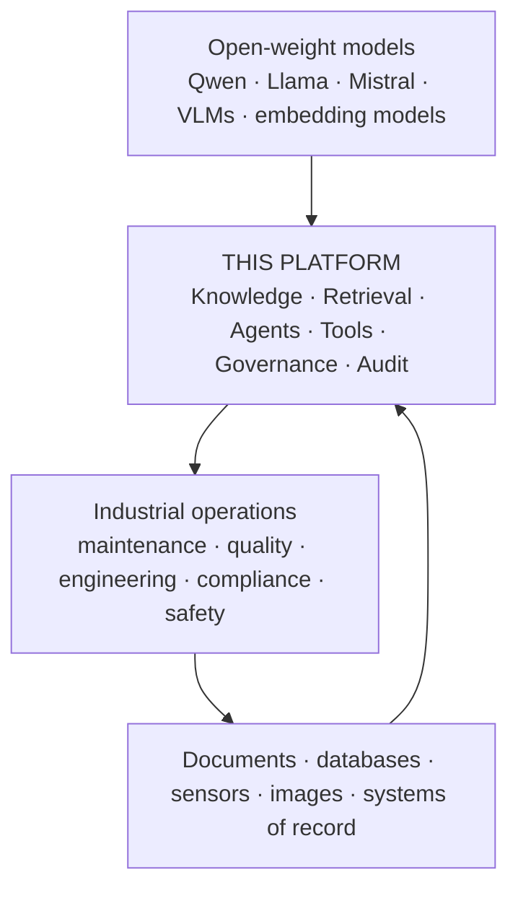
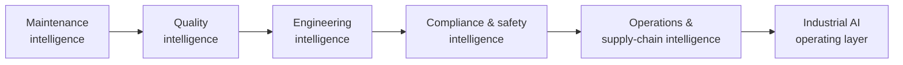
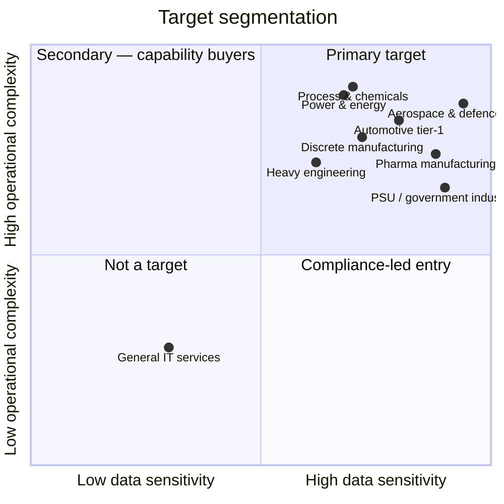
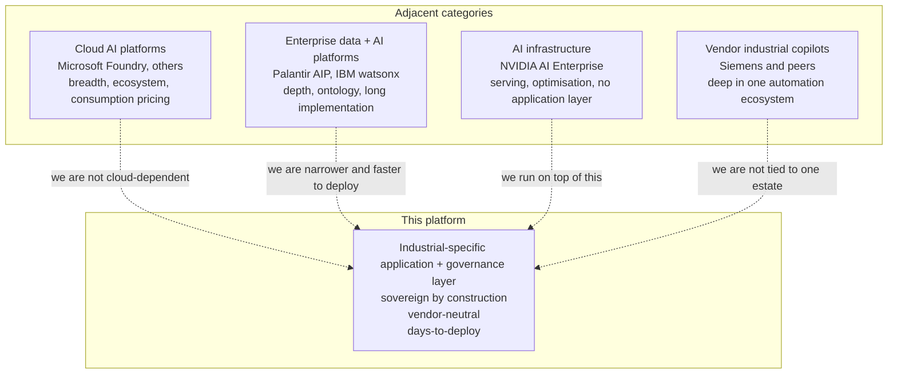

# 03 — Product Vision

**Document:** 03 of 35 · **Status:** Strategy · **See also:** [Index](00-index.md)

---

## 3.1 Vision

> **Every industrial organisation should be able to run a private AI workforce over its own confidential data — with the same capability as a cloud AI platform, and with more accountability than a human process.**

Two halves, both necessary. Capability parity without accountability produces a system that plant management will not authorise to touch anything. Accountability without capability parity produces a compliance artefact nobody uses. The vision is only met when both hold simultaneously.

## 3.2 Mission

To build the intelligence layer between open-weight AI models and industrial operations: a workbench that ingests confidential industrial knowledge, reasons over it with evidence, acts through governed tools, and proves what it did.

The strategic position is deliberate: **above the model layer, below the operational layer.** The platform does not train foundation models and does not replace plant control systems. It is the governed intermediary, and that is where the durable value sits — models commoditise, operations do not change vendors easily.

## 3.3 Long-term objective

**An AI operating layer for industrial organisations.**

Concretely, the objective is that within a customer's plant, the following becomes true:

| Today | Objective state |
|---|---|
| Knowledge lives in files that a person must find and read | Knowledge is queryable, permission-scoped and cited |
| Cross-system correlation is a manual exercise per incident | Correlation is a standing capability over a canonical asset identity |
| Automation is scripted, brittle and per-task | Automation is agentic, governed and reusable across tasks |
| AI decisions are unauditable or unmade | Every AI-influenced decision has a reconstructible trace |
| Senior expertise leaves with the person | Expertise is encoded in agents, knowledge bases and approved workflows |

The progression is by department, not by feature:

Each stage reuses the same platform primitives — ingestion, retrieval, agents, tools, governance, audit — and adds domain agents, connectors and evaluation sets. This is what makes departmental expansion cheap and is the core of the land-and-expand motion described in [26 — Business Model](26-business-model.md).

## 3.4 Product principles

These are decision rules, not slogans. Where a design choice is contested, the higher-numbered principle yields to the lower-numbered one.

| # | Principle | Practical consequence |
|---|---|---|
| 1 | **Sovereignty is binary, not a spectrum** | If a code path can reach the internet at request time, it is a defect. No "mostly local" mode. |
| 2 | **No unevidenced assertion** | If a claim cannot be linked to a source span, data row or tool output, the system says so rather than asserting it. |
| 3 | **Governance is on the critical path** | Policy, risk and audit are traversed by construction, not by convention. There is no "fast path" that skips them. |
| 4 | **Least privilege by intersection** | An agent acts with the intersection of the user's rights and the agent's grant. Never the union. Never a service account's rights. |
| 5 | **Read before write, always** | Every integration ships read-only first. Write capability is a separate, explicitly authorised decision per customer. |
| 6 | **Industrial first, generic second** | Where a general abstraction and an industrial-specific one conflict, choose the industrial one and expose the general one as configuration. |
| 7 | **Deployability is a feature** | A capability that cannot be installed in an air-gapped environment in days does not ship in the sovereign profile. |
| 8 | **Measure the claim** | Sovereignty, faithfulness, citation accuracy and approval coverage are metrics in the product, not assertions in the brochure. |

## 3.5 What this product is and is not

| It is | It is not |
|---|---|
| A workbench for building and governing industrial AI agents | A chatbot with document upload |
| A retrieval and reasoning layer over confidential data | A data lake, historian or MES |
| A model-agnostic serving and routing layer | A foundation-model training company |
| An action layer that proposes and executes governed operations | A control system or a safety-instrumented function |
| A governance and audit system for AI activity | A certification, or a guarantee of regulatory compliance |
| Vendor-neutral across automation estates | A component of one automation vendor's ecosystem |

### Explicit anti-goals

Naming what will not be built is as load-bearing as naming what will:

- **No control-system writes.** The platform will not write setpoints, modify PLC logic, or issue commands that influence a safety function. Ever, in any version. Actions terminate at business systems — work orders, notifications, reports, tickets.
- **No foundation-model pretraining.** Adapter-based fine-tuning on customer data is `[FUTURE]`; pretraining is out of scope permanently.
- **No cloud fallback.** There will be no "burst to cloud when local capacity is exhausted" mode, because its existence invalidates every sovereignty claim in the product.
- **No autonomous high-risk action.** HIGH and CRITICAL tiers always require a human. This is not a configuration default; it is a floor that customer configuration cannot lower below one approver.

## 3.6 Target market

### Segmentation logic

The buyer is defined by a two-axis test, not by industry label: **data sensitivity** × **operational complexity.** High on both means the pain is real and the alternative is unavailable.

### Beachhead

**Discrete and process manufacturing plants in India with 300–5,000 employees, an existing CMMS or maintenance-records estate, and at least one GPU-capable server or the budget for one.**

Rationale for this specific beachhead:

| Criterion | Why it selects this segment |
|---|---|
| Pain is acute and measurable | Unplanned downtime has a known hourly cost; investigation time is already tracked |
| Data is already digital but unusable | Manuals, work orders and reports exist as files; nobody can query across them |
| Buying authority is local | A plant head or operations director can authorise a pilot without a global IT programme |
| Sovereignty is a genuine blocker | Customer contracts and OEM licences make external AI use a real constraint, not a preference |
| Reference value compounds | Manufacturing buyers make decisions on peer references within the same sector |
| Expansion path is short | The second department is down the corridor, not in another country |

### Expansion sequence

| Wave | Segment | Entry workflow | Why later |
|---|---|---|---|
| 1 | Discrete + process manufacturing | Failure investigation | Beachhead |
| 2 | Automotive tier-1 and tier-2 | Quality deviation and customer-complaint investigation | Requires quality-agent maturity and supplier-document handling |
| 3 | Power, energy, heavy engineering | Asset reliability and outage investigation | Requires historian integration depth |
| 4 | Pharma and regulated manufacturing | SOP-versus-practice compliance evidence | Requires validation documentation and change-control discipline |
| 5 | Aerospace, defence supply, PSU | Air-gapped engineering and compliance work | Longest sales cycle; needs security accreditation and references |

Sequencing is driven by **sales-cycle length and evidence requirements**, not by technical difficulty. Defence and PSU buyers are the strongest fit for the sovereignty argument and the slowest to close; entering there first starves the company of revenue during the period it most needs references.

## 3.7 Positioning

### Positioning statement

> For industrial organisations whose most valuable data cannot leave their network, the Sovereign Industrial AI Workbench is an on-premise agentic AI platform that turns confidential manuals, records, data and images into evidence-backed answers and governed operational actions. Unlike cloud AI platforms, it operates with zero request-time external dependency; unlike general enterprise AI platforms, it ships with industrial agents, asset semantics and OT-safe integration patterns; and unlike single-vendor industrial copilots, it works across mixed automation estates.

### Competitive frame

The platform is positioned in the space between four adjacent categories, and its positioning is defined by what it refuses to be as much as by what it is.

Sourced comparison, including where competitors are stronger: [27 — Competitive Analysis](27-competitive-analysis.md).

### Category naming

| Candidate | Assessment |
|---|---|
| "AI SaaS for manufacturing" | Rejected — implies multi-tenant cloud, contradicts the core claim |
| "Private ChatGPT for industry" | Rejected — anchors on chat, understates the agent and governance layers, invites a per-seat price comparison |
| "Sovereign Industrial AI Infrastructure" | Accurate but positions against NVIDIA, which is a partner rather than a competitor |
| **"Industrial AI Operating Platform"** | **Selected** — conveys breadth, action orientation and the operating-layer ambition, and is priceable as platform software |

## 3.8 Business model shape

Detail in [26](26-business-model.md); the vision-level shape:

- **Perpetual or annual licence plus deployment and integration services**, not per-seat SaaS. Per-seat pricing is wrong here because value scales with assets and workflows covered, not with headcount, and because air-gapped deployments cannot support usage metering.
- **Land on one workflow, expand by department.** The first contract is a pilot on failure investigation. Expansion revenue comes from additional agents, additional knowledge domains and additional connectors.
- **Services are a feature, not a leak.** In air-gapped industrial environments, deployment and integration work is unavoidable. Pricing it explicitly, and reducing it over time through deployment-in-a-box, converts a cost centre into both revenue and a differentiator.

## 3.9 Success criteria by horizon

| Horizon | Success is | Failure signal |
|---|---|---|
| SIH prototype | The failure-investigation workflow runs end-to-end, fully offline, with citations, approval and audit trace | Demo depends on network access, or evidence cannot be traced to sources |
| First pilot | An engineering team uses it unprompted for real investigations for four consecutive weeks | Usage requires the vendor to be in the room |
| First paid deployment | Customer security review passes with the air-gap test, and a second department requests access | Deal stalls at network review; single-department stagnation |
| Product-market fit | Deployment time falls below two weeks without vendor engineers on site | Every deployment remains bespoke |
| Category position | A named industrial buyer chooses the platform over a general enterprise AI platform on industrial depth | Losing consistently on ecosystem breadth |

---

**Previous:** [02 — Problem Statement Analysis](02-problem-analysis.md) · **Next:** [04 — User Personas](04-user-personas.md)
