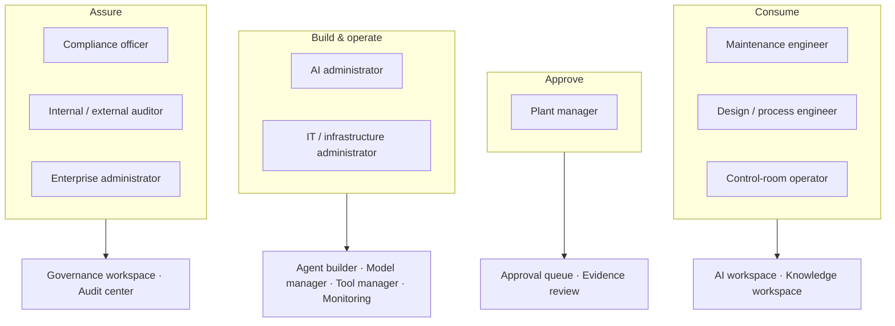
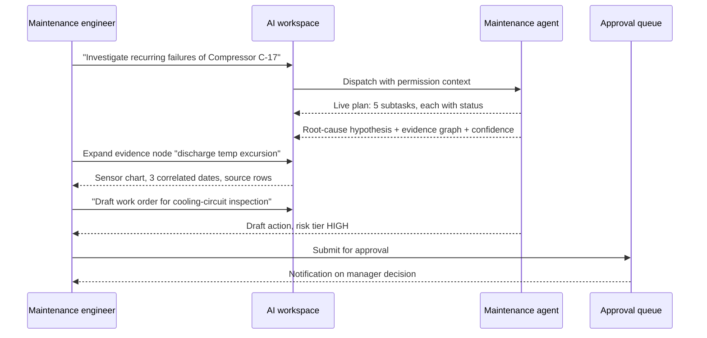
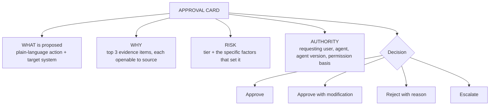
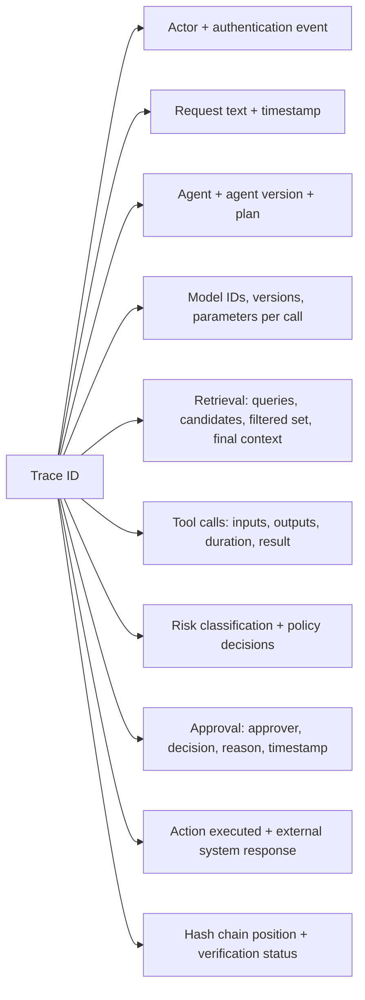

# 04 — User Personas

**Document:** 04 of 35 · **Status:** Design baseline · **See also:** [Index](00-index.md)

---

## 4.1 Purpose and method

Personas here exist to constrain engineering decisions, not to decorate a pitch. Each persona specifies: what the user is trying to achieve, what currently blocks them, the **exact permission set** they must hold, the workspaces they touch, and the acceptance test that proves the platform serves them. Permission names used here are the canonical scopes referenced throughout [05 — Functional Requirements](05-functional-requirements.md), [19 — API Architecture](19-api-architecture.md) and [20 — Database Design](20-database-design.md).

### Persona map against the platform

### Permission scope vocabulary

| Scope | Grants |
|---|---|
| `chat:use` | Submit queries to the AI workspace within permitted knowledge scope |
| `kb:read:{kb_id}` | Retrieve from a specific knowledge base |
| `kb:write:{kb_id}` | Upload, version and delete documents in a knowledge base |
| `kb:admin` | Create knowledge bases, set classification and permission rules |
| `agent:run:{agent_id}` | Execute a specific agent |
| `agent:build` | Create and edit agent definitions |
| `agent:publish` | Promote an agent version to production |
| `tool:use:{tool_id}` | Invoke a specific tool |
| `tool:admin` | Register, configure and disable tools and connectors |
| `action:approve:{risk_tier}` | Approve actions up to a given risk tier |
| `policy:read` / `policy:write` | View / modify governance policies |
| `model:admin` | Register, route and retire models |
| `audit:read` | Read audit events within organisational scope |
| `audit:export` | Export signed audit evidence packs |
| `system:admin` | Platform configuration, users, roles, deployment settings |
| `iam:admin` | Manage users, roles and role assignments |

Permission evaluation is always the **intersection** of user grant and agent grant (see [14.4](14-governance-architecture.md)). A persona's listed scopes describe the ceiling of what they can reach, never a guarantee of access to a specific document.

---

## 4.2 P1 — Maintenance engineer *(primary persona, MVP target)*

| Attribute | Detail |
|---|---|
| Context | Rotating equipment reliability at a single plant. 6–15 years' experience. Works from a laptop in an office adjacent to the shop floor, sometimes a tablet on the floor. |
| Reports to | Maintenance manager / plant manager |
| Technical comfort | High with equipment and CMMS, moderate with data tools, low with AI tooling. Will not tolerate prompt engineering. |

### Goals

1. Determine why a specific asset keeps failing, with evidence a supervisor will accept.
2. Find the correct procedure, torque, clearance or tolerance for a specific machine variant — quickly and without misapplying another variant's value.
3. Raise a correctly specified work order with the diagnosis attached.
4. Avoid repeating an investigation a colleague already completed two years ago.

### Problems today

- The relevant knowledge is split across a 400-page OEM manual, three years of shift logs on a network drive, a CMMS with inconsistent free-text fields, a historian export, and teardown photographs on someone's phone.
- Searching the document estate is filename-based. Full-text search, where it exists, returns hundreds of hits without ranking.
- Cross-referencing sensor behaviour against failure dates is a manual spreadsheet exercise, so it is usually skipped.
- Institutional memory is a phone call to a senior colleague who may have retired.

### Permissions

`chat:use`, `kb:read:{maintenance,equipment-manuals,failure-history}`, `agent:run:{maintenance,document,data-analyst,vision}`, `tool:use:{doc_search,sql_readonly,csv_analysis,image_analysis,report_generator}`

Notably **not** granted: `action:approve:*`, `agent:build`, `policy:*`. The engineer proposes; the manager approves.

### Expected interaction

### Acceptance test

Given the five-artefact C-17 corpus, the engineer reaches a defensible, cited root-cause hypothesis and a drafted work order **in a single session, without writing a follow-up prompt to correct the agent's scope**, and can open every cited source at the exact page or row.

### Failure modes that lose this persona

| Failure | Consequence |
|---|---|
| An answer that cannot be traced to a source | Trust lost permanently after one incident |
| A confidently wrong torque or clearance value | Escalates to a safety concern; platform is banned |
| Requiring more than one clarifying prompt for a standard investigation | Reverts to manual search |
| Latency over roughly a minute with no visible progress | Perceived as broken |

---

## 4.3 P2 — Design / process engineer

| Attribute | Detail |
|---|---|
| Context | Owns process parameters, engineering change and specification conformance. Works across drawings, standards and test data. |
| Technical comfort | High. Comfortable with CAD, spreadsheets, sometimes scripting. Sceptical of AI on engineering content — correctly. |

### Goals

1. Confirm whether a proposed change conflicts with an existing specification, standard or prior deviation.
2. Locate the design rationale behind a decision made years earlier.
3. Compare a supplier's submitted data against the applicable requirement.

### Problems today

- Standards, internal specifications and deviation records are separate estates with different vocabularies.
- Drawing content — dimensions, tolerance blocks, revision history, P&ID topology — is invisible to text search.
- Rationale is in email and meeting minutes, effectively unsearchable.

### Permissions

`chat:use`, `kb:read:{engineering,standards,specifications,deviations}`, `agent:run:{research,document,vision}`, `tool:use:{doc_search,image_analysis,report_generator}`

### Platform limitation to state plainly

Deep engineering-drawing comprehension — reading a dimensioned drawing's geometry, or traversing a P&ID's connectivity — is a known weakness of current vision-language models. MVP scope is **page-level visual understanding plus text and table extraction**, which supports "find the tolerance block and read it" but not "verify this assembly's stack-up." Diagram topology extraction is `[DIFF-P1]`, and full engineering-drawing reasoning is `[FUTURE]`. This persona is served partially in the MVP, and the documentation should not pretend otherwise.

### Acceptance test

For a change request naming a component and a parameter, the platform returns the governing specification clause, any prior deviation on the same parameter, and an explicit statement where it could not determine conformance — rather than guessing.

---

## 4.4 P3 — Control-room operator

| Attribute | Detail |
|---|---|
| Context | Shift-based, on a hardened operator workstation. Time-pressured; often responding to an active alarm. |
| Technical comfort | Deep on the process and the HMI, low on general IT. Cannot leave the panel to research. |

### Goals

1. Retrieve the correct response procedure for an active alarm in seconds.
2. Understand whether this alarm has occurred before on this asset and what resolved it.
3. Record what was observed and done, without typing a long report.

### Problems today

- Alarm response procedures are in binders or a document portal that is slow to search under pressure.
- Prior occurrences are in shift logs nobody has time to read mid-event.
- Handover notes are written at end of shift from memory.

### Permissions

`chat:use`, `kb:read:{sop,alarm-response,shift-logs}`, `agent:run:{document}`, `tool:use:{doc_search}`

Deliberately minimal. An operator persona is the **highest-consequence, lowest-latitude** user in the system: read-only, procedure-scoped, no data tools, no action tools.

### Design constraints this persona imposes

| Constraint | Requirement |
|---|---|
| Sub-5-second first useful output | Drives a fast-path retrieval mode that bypasses agent planning for direct procedure lookup — see [24](24-performance-requirements.md) |
| Zero-typing capture | Voice note transcription with local speech models — `[FUTURE]`, listed here because the persona justifies it |
| Unambiguous output | Procedure steps must render verbatim from the source with a visible source header, never paraphrased. Paraphrasing a safety procedure is a defect. |
| No agentic latitude | Operator queries route to a constrained retrieval path, not to a planning agent |

### Acceptance test

For an alarm code, the platform returns the governing procedure verbatim with its document identifier and revision, in under five seconds, and lists prior occurrences of the same code on the same asset.

---

## 4.5 P4 — Plant manager *(approver persona, MVP target)*

| Attribute | Detail |
|---|---|
| Context | Accountable for output, cost, safety and compliance at a site. Approves work, spend and deviations. |
| Technical comfort | Moderate. Consumes summaries; will not read a trace unless something looks wrong. |

### Goals

1. Approve or reject AI-proposed actions quickly, with enough evidence to be accountable for the decision.
2. Know which recurring problems are consuming maintenance capacity.
3. Be certain the platform cannot cause an uncontrolled action.

### Problems today

- Approvals arrive as verbal requests or thin emails; the evidence is elsewhere or absent.
- No consolidated view of recurring failure patterns across assets.
- Justified scepticism that an AI system might act beyond its authority.

### Permissions

`chat:use`, `kb:read:*` (site scope), `agent:run:*` (site scope), `action:approve:{LOW,MEDIUM,HIGH}`, `audit:read` (site scope)

CRITICAL-tier approval requires a **second** approver holding `action:approve:CRITICAL` — a multi-party control, not a single elevated role. See [14.6](14-governance-architecture.md).

### Expected interaction — the approval decision

The approval card is the highest-leverage screen in the product. It must answer four questions without a click:

Every decision path, including rejection and expiry, writes an audit event with the actor, timestamp, evidence hash and free-text reason where supplied.

### Acceptance test

The manager can decide on a HIGH-tier action in under 60 seconds, having seen the proposed action, its three strongest evidence items, its risk rationale and the requesting user — and any decision is reconstructible from the audit ledger twelve months later.

---

## 4.6 P5 — AI administrator *(builder persona, P1 target)*

| Attribute | Detail |
|---|---|
| Context | Plant digitalisation, IT-OT or automation engineering. The internal owner of the platform. Typically one or two people per site. |
| Technical comfort | High. Comfortable with configuration, data and APIs; not necessarily an ML engineer. |

### Goals

1. Configure agents for local workflows without waiting for the vendor.
2. Curate knowledge bases: what is ingested, how it is classified, who may retrieve it.
3. Select and route models against available GPU capacity.
4. Register tools and connectors safely.
5. Demonstrate to management that the platform is working and improving.

### Problems today

- Generic agent frameworks require code, which places this persona outside the loop.
- No visibility into why retrieval quality is poor for a given corpus.
- No safe way to test an agent change before exposing it to engineers.

### Permissions

`agent:build`, `agent:publish`, `kb:admin`, `tool:admin`, `model:admin`, `policy:read`, `audit:read`

Deliberately **not** `action:approve:*`. Whoever builds the automation must not also be able to approve its consequential actions — a separation-of-duties control.

### Required capabilities

| Capability | Status | Rationale |
|---|---|---|
| Visual agent builder with typed nodes | `[DIFF-P1]` | Configuration, not code, is the point of this persona |
| Agent versioning with rollback | `[DIFF-P1]` | Publishing a regression must be reversible in one action |
| Sandbox test runs against a golden set | `[DIFF-P1]` | Changes must be measurable before publication — see [23](23-ai-evaluation.md) |
| Retrieval diagnostics | `[DIFF-P1]` | Shows what was retrieved, what was reranked out, and what permissions filtered |
| Model routing with VRAM budget view | `[DIFF-P1]` | Prevents configuring a model set that cannot co-reside on the available GPU |

### Acceptance test

Without writing code, the administrator creates a new agent from a template, assigns two knowledge bases and three tools, runs it against a golden question set, compares scores to the previous version, publishes it, and rolls it back — all from the workbench.

---

## 4.7 P6 — IT / infrastructure administrator

| Attribute | Detail |
|---|---|
| Context | Owns servers, network, backup and identity. The gatekeeper who can block the deployment entirely. |
| Technical comfort | High on infrastructure. Institutionally sceptical of anything introducing new network exposure or GPU workloads. |

### Goals

1. Deploy and operate the platform within existing network, identity and backup standards.
2. Prove the platform makes no outbound connections.
3. Patch and update it, including in an air-gapped environment.
4. Keep it running: capacity, storage growth, failure recovery.

### Problems today

- Vendor "on-premise" deployments frequently require egress for licensing, telemetry or model downloads.
- No clear guidance on GPU sizing for a mixed local-model workload.
- Air-gapped patching is usually an afterthought.

### Permissions

`system:admin`, `iam:admin`, `audit:read`, `model:admin`

Not granted: `kb:read:*`. **A platform administrator does not automatically gain read access to confidential knowledge.** Content access requires an explicit, separately audited grant. This distinction is one of the more important security decisions in the product and is enforced at the retrieval layer, not the UI. See [13.5](13-security-architecture.md).

### Required capabilities

| Capability | Status |
|---|---|
| Single-command Docker Compose deployment | `[MVP-P0]` |
| Offline artefact bundle including model weights | `[MVP-P0]` |
| Egress attempt monitoring and alerting | `[DIFF-P1]` |
| Backup and restore procedure covering Postgres, vector store and object store | `[DIFF-P1]` |
| OIDC/SAML integration with existing identity provider | `[PROPOSED]` |
| Kubernetes deployment with HA | `[FUTURE]` |
| Documented GPU sizing model | `[MVP-P0]` — see [24.6](24-performance-requirements.md) |

### Acceptance test

The administrator deploys the platform on an air-gapped host from the offline bundle, runs the full failure-investigation workflow, and observes zero outbound connection attempts at the network layer.

---

## 4.8 P7 — Compliance officer

| Attribute | Detail |
|---|---|
| Context | Quality management systems, regulatory submissions and internal standards. Speaks in evidence, deviations and CAPAs. |
| Technical comfort | Moderate. Fluent in audit trails and document control; not in AI. |

### Goals

1. Detect where actual practice diverges from the governing SOP.
2. Assemble an evidence pack for an audit without a two-week manual exercise.
3. Establish that the AI system itself is under control — which model, which prompt, which policy, which approver.

### Problems today

- SOP-versus-practice comparison is sampling-based because exhaustive review is impossible manually.
- Evidence assembly means chasing documents, emails and signatures across systems.
- AI systems are an emerging audit finding in their own right, with no established evidence format.

### Permissions

`chat:use`, `kb:read:{sop,quality,compliance,deviations}`, `agent:run:{compliance,document}`, `audit:read`, `audit:export`, `policy:read`

### What this persona uniquely requires

| Requirement | Why |
|---|---|
| Document revision awareness | A deviation is only meaningful against the SOP revision in force at that time. Retrieval must be able to answer as-of a date. |
| Signed evidence export | An audit pack must be verifiable outside the platform — see [15.7](15-audit-architecture.md) |
| Model and prompt provenance per answer | The AI system is itself in scope of audit. NIST AI RMF's Govern and Measure functions map directly here ([nist.gov](https://www.nist.gov/itl/ai-risk-management-framework)). |
| Explicit uncertainty | "I could not determine conformance" must be an available, visible outcome. A compliance answer that hides uncertainty is worse than no answer. |

### Acceptance test

For a named SOP and a date range, the platform lists candidate deviations, each cited to the practice record and the SOP clause **as in force at that time**, and exports a signed evidence pack that verifies independently.

---

## 4.9 P8 — Auditor (internal or external)

| Attribute | Detail |
|---|---|
| Context | Periodic, adversarial by role. May be external and time-boxed. Assumes nothing. |
| Technical comfort | Variable. Requires readable, self-contained evidence. |

### Goals

1. Reconstruct exactly what the system did for a given decision.
2. Verify that records have not been altered.
3. Establish who authorised what, and whether authority was exceeded.

### Permissions

`audit:read` (scoped to engagement), `audit:export`

**No** `chat:use`, no agent execution, no knowledge read. An auditor examines the record; they do not operate the system. This keeps the audit boundary clean and prevents an auditor's activity from contaminating the record they are auditing.

### What the platform must produce

### Acceptance test

Given only a trace ID, the auditor reconstructs the complete decision chain, verifies the hash chain over the relevant range, and identifies every human who exercised authority — without vendor assistance and without platform write access.

---

## 4.10 P9 — Enterprise administrator *(multi-site, FUTURE)*

| Attribute | Detail |
|---|---|
| Context | Corporate IT or digital function governing several plants. Emerges only after multi-site deployment. |
| Technical comfort | High, organisationally oriented. |

### Goals

1. Enforce consistent policy across sites while allowing local configuration.
2. Compare adoption and value across sites.
3. Promote a validated agent from one site to others.

### Permissions

`policy:write` (org scope), `audit:read` (org scope), `system:admin` (org scope), `agent:publish` (org scope)

### Status

`[FUTURE]`. Included because it constrains two MVP-era schema decisions that would be expensive to retrofit:

1. Every tenant-scoped table carries `organization_id` **and** `site_id` from the first migration.
2. Policies and agent definitions are versioned objects with an inheritance model (org → site → project), even though the MVP only ever populates one site.

Getting these two decisions right at schema-design time costs almost nothing; retrofitting them after a customer has production data is a multi-week migration. See [20.4](20-database-design.md).

---

## 4.11 Persona-to-scope matrix

| Persona | MVP (P0) | Differentiators (P1) | Future (P2+) |
|---|---|---|---|
| P1 Maintenance engineer | **Fully served** — primary demonstration persona | Agent memory, better retrieval | Predictive correlation |
| P2 Design engineer | Partially — text and tables only | Diagram topology extraction | Engineering-drawing reasoning |
| P3 Operator | Partially — procedure retrieval only | Fast-path retrieval mode | Voice capture, HMI embedding |
| P4 Plant manager | **Fully served** — approval queue with evidence | Multi-level approval, dashboards | Cross-site pattern analytics |
| P5 AI administrator | Partially — configuration via API/config | Visual agent builder, versioning, evaluation | Agent marketplace |
| P6 IT administrator | **Fully served** — Compose deploy, offline bundle | Egress monitoring, backup tooling, SSO | Kubernetes HA, multi-site |
| P7 Compliance officer | Partially — cited answers over SOP corpus | Compliance agent, as-of retrieval, signed export | Automated CAPA workflow |
| P8 Auditor | **Fully served** — full trace, hash-chained ledger | Verification tooling, export formats | External SIEM streaming |
| P9 Enterprise administrator | Not served — schema readiness only | Not served | Full multi-site governance |

Four personas are fully served in the MVP. That is the correct number: the demonstration requires a practitioner, an approver, an operator of the platform and an auditor, because those four together prove the end-to-end governance claim. Serving all nine at MVP would mean serving none of them well.

---

**Previous:** [03 — Product Vision](03-product-vision.md) · **Next:** [05 — Functional Requirements](05-functional-requirements.md)
